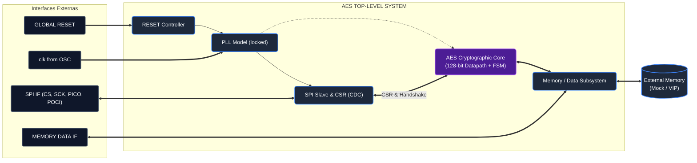

# Hands-on CIExpert — Acelerador Criptográfico AES com Interface SPI

[](https://en.wikipedia.org/wiki/SystemVerilog)
[](#2-ambiente-de-desenvolvimento)
[](#2-ambiente-de-desenvolvimento)
[](#3-comandos-de-geração-e-automação)

Repositório dedicado ao desenvolvimento de hardware do projeto **Hands-on CIExpert (RTL Design Track)**. O projeto contempla o design, verificação, síntese e otimização de baixo consumo de um **IP Digital acelerador criptográfico AES-128 (NIST FIPS-197)**, controlado via interface serial **SPI Slave**, com tratamento de múltiplos domínios de clock (**CDC**) e intenção de potência em **UPF (IEEE 1801)**.

---

## 1. Visão Geral do Projeto

O sistema desenvolvido é o **`AES Top-Level System`**, concebido como um IP parametrizável e sintetizável integrado com interface externa de barramento e subsistema de memória:



### Principais Componentes do Sistema:
- **Núcleo Criptográfico AES-128**: Datapath iterativo para blocos de 128 bits e suporte à expansão de chaves (*on-the-fly*);
- **Interface SPI Slave & CSR**: Recepção/transmissão serial síncrona, banco de registradores de controle e status, e barreira de sincronização entre domínios de clock (*Clock Domain Crossing* — `SCLK` vs `clk_sys`);
- **Gerenciamento de Clock & Reset**: Controlador de reset assíncrono com desativação síncrona e modelo de PLL com sinal de travamento (`locked`);
- **Subsistema de Dados**: Interface de arbitragem para alimentação de blocos em claro (*Plaintext*) e devolução do bloco cifrado (*Ciphertext*);
- **Arquitetura de Baixo Consumo**: Intenção de potência descrita em UPF (IEEE 1801), integrando estratégias de *Clock Gating* (ICG) e *Power Gating*.

---

## 2. Ambiente de Desenvolvimento

O ambiente está configurado para a infraestrutura corporativa do programa, utilizando o ecossistema de ferramentas EDA da **Synopsys** associado ao PDK comercial **Synopsys SAED 32nm**.

### 2.1 Ferramental EDA

| Ferramenta Synopsys | Binário | Função no Fluxo de Desenvolvimento |
| :--- | :---: | :--- |
| **VCS / Vlogan** | `vcs`, `vlogan` | Análise estrita de sintaxe (`+lint=all`), compilação SystemVerilog e simulação RTL. |
| **Design Compiler** | `dc_shell` | Síntese lógica estrutural, mapeamento para o PDK SAED 32nm e restrições SDC. |
| **Formality** | `fm_shell` | Verificação formal de equivalência booleana (RTL Golden vs. Netlist de portas). |
| **VC Static** | `vc_static` | Validação estática de intenção de baixo consumo (regras UPF / IEEE 1801). |
| **Verdi / DVE** | `verdi`, `dve` | Depuração interativa de formas de onda e transições de múltiplos domínios de clock. |

### 2.2 Process Design Kit (Synopsys SAED 32nm)
* **Modelos Comportamentais Verilog**: Células padrão RVT (*Regular Threshold Voltage*) em 32nm.
* **Bibliotecas Liberty Compiladas (.db)**: Caracterizadas para condições nominais ($1.05\,\text{V}$, $25^\circ\text{C}$).

### 2.3 Configuração do Ambiente (`utils/enable_tools.sh`)
O script [`utils/enable_tools.sh`](utils/enable_tools.sh) automatiza as variáveis de ambiente necessárias (licenças Synopsys, `PATH` e exportação automática do `DISPLAY` para suporte a sessões remotas via **X2Go**). Ele é carregado de forma transparente pelo Makefile quando necessário.

---

## 3. Comandos de Geração e Automação

O projeto conta com um fluxo automatizado centralizado no [`Makefile`](Makefile), garantindo reprodutibilidade em comando único (*single-command execution*) e isolamento de builds no diretório `build/`.

### 3.1 Execução Rápida (*Quick Start*)

Para executar o fluxo básico de lint, compilação e simulação em um comando:
```bash
make sim
```

Para executar o fluxo completo integrado (Simulação $\to$ Síntese $\to$ Verificação Formal $\to$ UPF):
```bash
make all
```

### 3.2 Tabela de Comandos do Makefile

| Comando | Descrição do Fluxo Executado | Saídas Principais |
| :--- | :--- | :--- |
| **`make sim`** | Executa linting, compilação com VCS e roda a simulação funcional. | `tb/rtl_simulation.log`, `build/sim_rtl/` |
| **`make lint`** | Executa checagem de sintaxe estrita SystemVerilog (`vlogan +lint=all`). | `tb/lint.log` |
| **`make compile`** | Compila o RTL e o testbench gerando o executável binário `simv`. | `tb/compile.log`, `build/sim_rtl/simv` |
| **`make synth`** | Executa a síntese lógica com Design Compiler contra o PDK SAED 32nm. | `build/syn/top_syn.v`, `syn/synthesis.log` |
| **`make formal`** | Executa a verificação de equivalência formal lógica no Formality. | `formal/formality.log` |
| **`make upf_check`** | Executa a checagem estática de intenção de energia com VC Static. | `upf/upf_static.log` |
| **`make all`** / **`make run`** | Executa sequencialmente simulação, síntese, formal e UPF. | Todos os artefatos em `build/` |
| **`make check_tools`** | Diagnóstico rápido no terminal verificando presença das ferramentas no `PATH`. | Exibição no terminal |
| **`make clean`** | Remove o diretório temporário `build/` e arquivos de log intermediários. | Workspace limpo |
| **`make clean_all`** | Remove os builds e as cópias locais de bibliotecas em `libs/`. | Repositório em estado original |

---

## 4. Estrutura do Repositório

O repositório adota separação estrita entre fontes de projeto, infraestrutura e documentação:

```text
.
├── Makefile                # Motor central de automação e orquestração do fluxo
├── README.md               # Este documento de apresentação e guia do ambiente
│
├── docs/                   # Documentação técnica centralizada
│   ├── references/         # Normas oficiais e planejamento (FIPS-197, Planejamento)
│   ├── reports/            # Relatórios semanais de entrega e imagens
│   │   ├── BACKLOG.md      # Backlog do projeto e planejamento ágil (User Stories)
│   │   └── semana_01.md    # Relatório técnico da Semana 1 (Estudo SPI & AES)
│   ├── architecture/       # Especificação e diagramas de arquitetura (v1.0)
│   └── spec/               # Especificações detalhadas de registradores e interfaces
│
├── rtl/                    # Fontes sintetizáveis em SystemVerilog (.sv)
├── tb/                     # Testbenches funcionais dirigidos e arquivos de estímulo
├── models/                 # Modelos comportamentais de teste (mocks de PLL e Memória)
├── syn/                    # Scripts TCL de síntese, restrições SDC e relatórios
├── formal/                 # Scripts de verificação formal no Formality
├── upf/                    # Arquivos de intenção de baixo consumo (UPF / IEEE 1801)
├── utils/                  # Utilitários de infraestrutura (enable_tools.sh)
├── scripts/                # Scripts auxiliares de pós-processamento
│
├── libs/                   # (Gerado) Cópias locais das bibliotecas do PDK SAED 32nm
└── build/                  # (Gerado) Diretório isolado para todos os artefatos de build
```

---

## 5. Documentação e Relatórios Técnicos

Toda a documentação técnica detalhada, cronograma, estudos teóricos e relatórios semanais de entrega estão concentrados no diretório [`docs/`](docs/):

* **[Backlog do Projeto (BACKLOG.md)](docs/reports/BACKLOG.md)**: Planejamento completo das 15 semanas dividido em 7 *User Stories* (especificação, RTL, síntese, formal, UPF, baixo consumo e encerramento).
* **[Relatório da Semana 1 (semana_01.md)](docs/reports/semana_01.md)**: Kick-off, estudo teórico do protocolo SPI (sinais PICO/POCI, modos de operação, acesso a registradores) e do AES (FIPS-197, fluxo dos rounds, S-Box, MixColumns) e validação do ambiente.
* **[Documentos de Referência](docs/references/)**: Normas técnicas oficiais ([NIST FIPS-197](docs/references/nist.fips.197.pdf)) e diretrizes do programa ([Planejamento-Projeto-Hands-on.pdf](docs/references/Planejamento-Projeto-Hands-on.pdf)).
