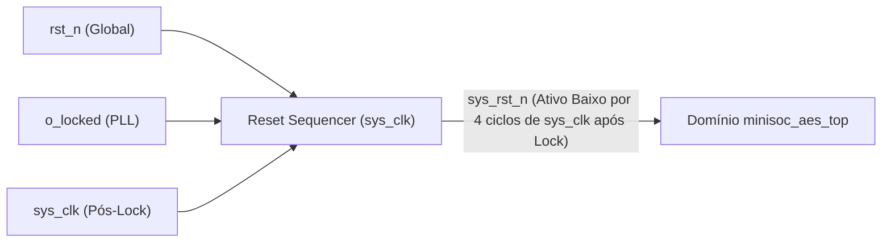
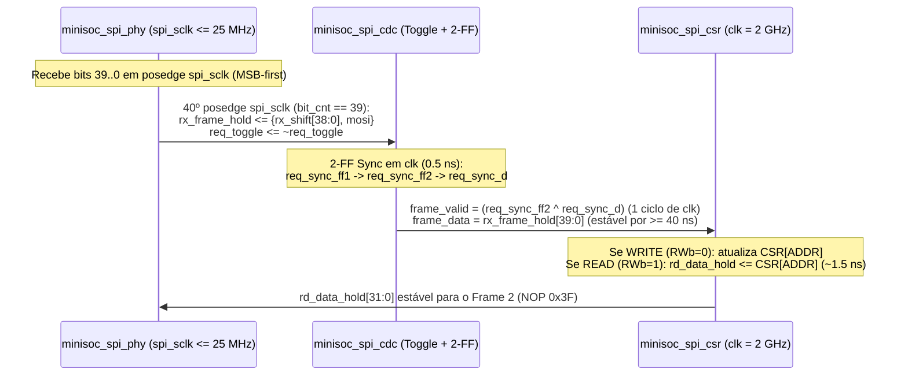
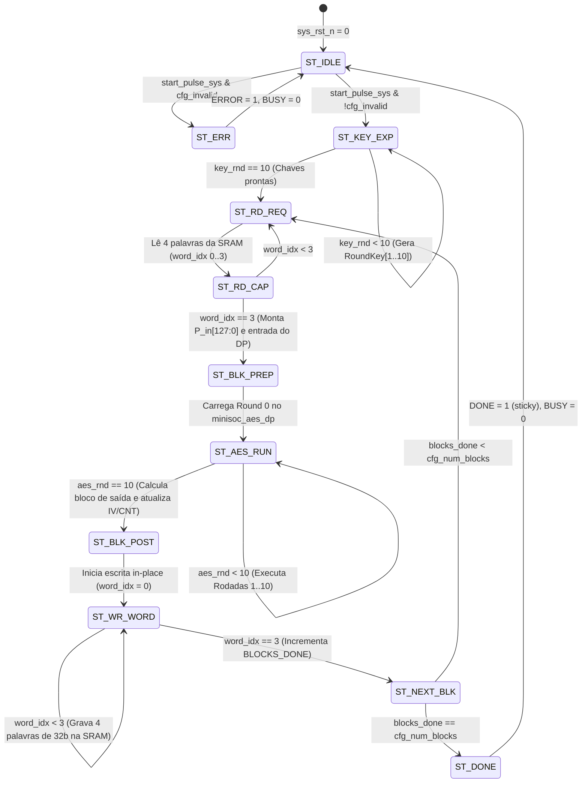

# Documento de Arquitetura e Microarquitetura — MiniSoC AES (v1.0.0)

**Projeto:** Hands-on CIExpert — RTL Design Track  
**Autor:** Anderson Pereira  
**Documentos de Referência:**
- [DV_BlockGuide_MiniSoCAES_v1.0.0.pdf](../references/DV_BlockGuide_MiniSoCAES_v1.0.0.pdf) *(System Architecture and RTL Specification)*
- [Planejamento-Projeto-Hands-on.pdf](../references/Planejamento-Projeto-Hands-on.pdf)
- [NIST FIPS PUB 197 (AES Standard)](../references/nist.fips.197.pdf)

---

## 1. Visão Geral e Diagrama de Blocos Interno (`MiniSoC AES`)

O **`MiniSoC AES`** (`minisoc_top`) é um sistema digital integrado em SystemVerilog que reúne, em um único *top-level*, um **Front-End SPI** de configuração e monitoramento, um **gerador/divisor de clock PLL (`minisoc_pll_mock`)**, um **Engine Criptográfico AES-128 multi-modo** e uma **memória física compartilhada de $1024 \times 32$ bits (`minisoc_memory`)** com processamento *in-place*.

O circuito atende integralmente às especificações do ambiente de verificação parceiro (*Design Verification Track*) e aos fluxos industriais Synopsys (VCS/Vlogan, Design Compiler, Formality, PrimeTime e VC Static / UPF IEEE 1801) sobre o PDK **Synopsys SAED 32nm**.

### 1.1 Diagrama de Blocos Interno do Sistema (`minisoc_top`)

```text
========================================================================================================================
                                        MINISOC AES TOP-LEVEL SYSTEM (minisoc_top)
========================================================================================================================

  INTERFACES DE TOPO
  ==================
  • CLK            : clk (Referência always-on de 2 GHz)
  • RESET          : rst_n (Reset global ativo em nível baixo)
  • SPI            : spi_sclk (<= 25 MHz), spi_cs_n, spi_mosi, spi_miso
  • MEMORY DATA IF : mem_clk (<= 200 MHz), mem_i_data[31:0], mem_i_wr_en, mem_i_addr[9:0], mem_o_data[31:0]

                 clk (2 GHz Always-On)                        rst_n (Global Reset)
                           │                                           │
           ┌───────────────┼───────────────────────────────────────────┼──────────────────────┐
           │               ▼                                           ▼                      │
           │    ┌──────────────────────┐                    ┌────────────────────┐            │
           │    │   minisoc_pll_mock   │                    │  Reset Sequencer   │            │
           │    │ • Enable & Div (/1..8)├───── o_locked ────►│ • Gera sys_rst_n   │            │
           │    │ • LFSR Lock Delay    │      (status)      │   pós-lock determ. │            │
           │    └──────────┬───────────┘                    └──────────┬─────────┘            │
           │               │ sys_clk (2GHz/1GHz/500MHz/250MHz)         │ sys_rst_n            │
           ▼               │                                           │                      ▼
  ┌─────────────────────────┐                                          │           ┌────────────────────┐
  │      minisoc_spi        │◄── spi_sclk, spi_cs_n, spi_mosi, spi_miso│           │                    │
  │  ┌───────────────────┐  │                                          │           │                    │
  │  │ minisoc_spi_phy   │  │ (Domínio spi_sclk: Frame 40b Mode 0)     │           │                    │
  │  ├───────────────────┤  │                                          │           │                    │
  │  │ minisoc_spi_cdc   │  │ (Toggle de Frame Completo + Data-Hold)   │           │                    │
  │  ├───────────────────┤  │                                          ▼           │                    │
  │  │ minisoc_spi_csr   │  │ (Domínio clk 2 GHz Always-On: CSRs 32b) ┌───────────────────────┐         │
  │  └─────────┬─────────┘  │                                         │    minisoc_aes_top    │         │
  └────────────┼────────────┘                                         │  • Controlador Blocos │         │
               │ KEY, IV, COUNTER, NUM_BLOCKS, MODE, DECRYPT, START   │    (ECB,CBC,PCBC,     │         │
               ├─────────────────────────────────────────────────────►│     CFB,OFB,CTR)      │         │
               │◄─────────────────────────────────────────────────────┤  • minisoc_aes_dp     │         │
               │ BUSY, DONE, ERROR, BLOCKS_DONE (CDC clk <-> sys_clk) │  • minisoc_aes_key_exp│         │
               │                                                      └───────────┬───────────┘         │
               │ MEM_SEL_AES (Ownership Select)                                   │ Porta AES (sys_clk) │
               │                                                                  ▼                     │
               │      Porta Externa MEMORY DATA IF (mem_clk) ────────► ┌─────────────────────┐          │
               └─────────────────────────────────────────────────────► │   Mux de Memória    │          │
                                                                       │ (Exclusão Mútua)    │          │
                                                                       └──────────┬──────────┘          │
                                                                                  ▼                     │
                                                                       ┌─────────────────────┐          │
                                                                       │   minisoc_memory    │          │
                                                                       │  SRAM 1024 x 32 bits│          │
                                                                       └─────────────────────┘          │
```

### 1.2 Convenções de Módulos e Organização RTL (Seções 1.3 e 10)

| Arquivo / Módulo | Papel Funcional no Sistema |
| :--- | :--- |
| [`rtl/minisoc_top.sv`](../../rtl/top.sv) | Top-level de integração do sistema completo (expõe apenas as 4 interfaces de topo). |
| [`rtl/minisoc_spi/minisoc_spi.sv`](../../rtl/minisoc_spi/minisoc_spi.sv) | Wrapper do Front-End SPI integrando `minisoc_spi_phy`, `minisoc_spi_cdc` e `minisoc_spi_csr`. |
| `rtl/minisoc_aes/minisoc_aes_top.sv` | Engine AES, FSM de controle multi-bloco, encadeamento de modos, CDC e acesso à memória. |
| `rtl/minisoc_aes/minisoc_aes_dp.sv` | Datapath AES-128 iterativo (1 rodada/ciclo) com suporte a *Cipher* e *Inverse Cipher*. |
| `rtl/minisoc_aes/minisoc_aes_key_exp.sv` | Expansor de chaves AES-128 (geração das 11 *round keys* `RoundKey[0..10]`). |
| [`rtl/minisoc_aes/minisoc_aes_pkg.sv`](../../rtl/minisoc_aes/minisoc_aes_pkg.sv) | Tipos (`aes_state_t` *column-major*) e aritmética em $\text{GF}(2^8)$ (`xtime`, `{03}`, `{09}`, `{0b}`, `{0d}`, `{0e}`). |
| [`rtl/minisoc_aes/minisoc_aes_sbox.sv`](../../rtl/minisoc_aes/minisoc_aes_sbox.sv) / [`inv_sbox.sv`](../../rtl/minisoc_aes/minisoc_aes_inv_sbox.sv) | Tabelas de substituição S-Box e Inverse S-Box (`8b -> 8b`, Figuras 7 e 14 da FIPS-197). |
| [`rtl/minisoc_aes/minisoc_aes_sub_bytes.sv`](../../rtl/minisoc_aes/minisoc_aes_sub_bytes.sv) / [`inv_sub_bytes.sv`](../../rtl/minisoc_aes/minisoc_aes_inv_sub_bytes.sv) | Transformações combinacionais `SubBytes` e `InvSubBytes` (`128b -> 128b`, 16 S-Boxes em paralelo). |
| [`rtl/minisoc_aes/minisoc_aes_shift_rows.sv`](../../rtl/minisoc_aes/minisoc_aes_shift_rows.sv) / [`inv_shift_rows.sv`](../../rtl/minisoc_aes/minisoc_aes_inv_shift_rows.sv) | Transformações combinacionais `ShiftRows` e `InvShiftRows` por permutação pura de barramentos. |
| [`rtl/minisoc_aes/minisoc_aes_mix_columns.sv`](../../rtl/minisoc_aes/minisoc_aes_mix_columns.sv) / [`inv_mix_columns.sv`](../../rtl/minisoc_aes/minisoc_aes_inv_mix_columns.sv) | Transformações combinacionais `MixColumns` e `InvMixColumns` em $\text{GF}(2^8)$ módulo $x^4+1$. |
| [`rtl/minisoc_aes/minisoc_aes_add_round_key.sv`](../../rtl/minisoc_aes/minisoc_aes_add_round_key.sv) | Transformação combinacional `AddRoundKey` (`i_state ^ i_round_key`, autoinversa). |
| [`rtl/minisoc_mem/minisoc_memory.sv`](../../rtl/minisoc_mem/minisoc_memory.sv) | Modelo RTL da memória física compartilhada single-port $1024 \times 32$ bits. |
| [`rtl/minisoc_pll/minisoc_pll_mock.sv`](../../rtl/minisoc_pll/minisoc_pll_mock.sv) | Modelo RTL sintetizável do PLL (referência de 2 GHz, divisores `/1, /2, /4, /8`). |

---

## 2. Interfaces de Topo (`minisoc_top.sv` — Seção 3)

O top-level expõe estritamente quatro grupos de sinais externos:

| Grupo | Sinal | Direção | Largura | Domínio | Descrição Funcional |
| :--- | :--- | :---: | :---: | :---: | :--- |
| **CLK** | `clk` | Input | 1 | `clk` (2 GHz) | Clock de referência de **2 GHz**. Alimenta o PLL mock e o domínio always-on de controle/SPI. |
| **RESET** | `rst_n` | Input | 1 | Assíncrono | Reset global ativo em nível baixo (`0`). Não apaga o conteúdo da memória de dados. |
| **SPI** | `spi_sclk` | Input | 1 | `spi_sclk` | Clock serial SPI Mode 0. Frequência máxima especificada: **25 MHz**. |
| | `spi_cs_n` | Input | 1 | `spi_sclk` | *Chip Select* ativo em nível baixo (`0`). Delimita cada frame de 40 bits. |
| | `spi_mosi` | Input | 1 | `spi_sclk` | Linha de dados serializados Mestre $\to$ Escravo (amostrada em `posedge spi_sclk`). |
| | `spi_miso` | Output | 1 | `spi_sclk` | Linha de dados serializados Escravo $\to$ Mestre (atualizada em `negedge spi_sclk`). |
| **MEMORY DATA** | `mem_clk` | Input | 1 | `mem_clk` | Clock externo da interface de memória (até **200 MHz**). |
| | `mem_i_data` | Input | 32 | `mem_clk` | Palavra de 32 bits para escrita externa na memória. |
| | `mem_i_wr_en` | Input | 1 | `mem_clk` | Controle de operação (`1 = write`, `0 = read`). |
| | `mem_i_addr` | Input | 10 | `mem_clk` | Endereço de palavra de 32 bits na memória (`0..1023`). |
| | `mem_o_data` | Output | 32 | `mem_clk` | Dado de 32 bits retornado em leituras síncronas da memória. |

---

## 3. Estratégia de Clock, PLL, Sequência de Reset (Seção 4.2) e CDC (Seção 5.3)

### 3.1 Relação de Clocks e Regra de Bootstrap (Seções 2.2 e 4)
O sistema opera com quatro domínios de clock:
1. **`clk` (2.000 GHz Always-On):** Alimenta o `minisoc_pll_mock` e o banco CSR do `minisoc_spi`. **Regra de Bootstrap:** como o SPI utiliza `clk` e independe de `sys_clk`, o software consegue programar `PLL_DIV_SEL`, habilitar `PLL_ENABLE = 1` e monitorar `PLL_LOCKED` mesmo enquanto `sys_clk` está totalmente bloqueado em `0`.
2. **`sys_clk` (2 GHz / 1 GHz / 500 MHz / 250 MHz):** Gerado pelo `minisoc_pll_mock` e liberado de forma *glitch-free* somente após `PLL_LOCKED = 1` (`REQ-PLL-01`):

| `PLL_DIV_SEL` | Divisor | Frequência de `sys_clk` | Período |
| :---: | :---: | :---: | :---: |
| `2'b00` | `/1` | `2.000 GHz` | `0.5 ns` |
| `2'b01` | `/2` | `1.000 GHz` | `1.0 ns` |
| `2'b10` | `/4` | `  500 MHz` | `2.0 ns` |
| `2'b11` | `/8` | `  250 MHz` | `4.0 ns` |

3. **`spi_sclk` ($\le 25\text{ MHz}$):** Clock serial externo assíncrono, ativo apenas durante janelas `spi_cs_n = 0`.
4. **`mem_clk` ($\le 200\text{ MHz}$):** Clock externo encaminhado à SRAM quando `MEM_SEL_AES = 0`.

### 3.2 Sequência de Reset do Domínio do Sistema (Seção 4.2 — Foco em QoR)

Conforme a **Seção 4.2 do Block Guide**, o clock `sys_clk` permanece fisicamente parado em `0` enquanto `PLL_LOCKED == 0`. Para maximizar o QoR no Synopsys Design Compiler (SAED 32nm) — eliminando arcos de *recovery/removal* a `2 GHz`, facilitando *Clock Gating* (ICG) e simplificando Formality e VC Static — todos os registradores de `minisoc_aes_*` utilizam **reset síncrono** (`always_ff @(posedge sys_clk) if (!sys_rst_n)`), alimentados pelo sequenciador de reset interno do `minisoc_top`:



1. **Enquanto `!rst_n || !pll_locked`:** O contador de reset pós-lock (`rst_cnt[2:0]`) é mantido zerado e `sys_rst_n = 1'b0`.
2. **Após `pll_locked == 1` e liberação de `sys_clk`:** A cada borda de subida de `sys_clk`, o sequenciador incrementa `rst_cnt` durante **4 ciclos ativos de `sys_clk`** com `sys_rst_n = 1'b0`. Durante essas 4 bordas de subida de `sys_clk`, todos os flip-flops síncronos do `minisoc_aes_top`, `minisoc_aes_dp` e `minisoc_aes_key_exp` recebem clock ativo com `sys_rst_n == 0`, inicializando deterministicamente antes da subida de `sys_rst_n <= 1'b1`.
3. **Se o PLL perder o lock (`pll_locked -> 0`) ou ocorrer `rst_n == 0`:** `sys_rst_n` retorna imediatamente a `0`.
4. **Exceções Assíncronas Estritas na Fronteira Serial (`spi_sclk`):** Como `spi_sclk` está parado fora das transações SPI, `minisoc_spi_phy` utiliza reset assíncrono por `spi_cs_n = 1` (enquadramento/aborto de *runt frames*) e os 2 registradores fonte de `minisoc_spi_cdc` (`req_toggle` e `rx_frame_hold`) usam `negedge rst_n` assíncrono para impedir propagação de `'X'`.
5. **Memória Física (`minisoc_memory`):** Não possui reset funcional no array (Seções 3 e 7.3).

### 3.3 Estratégia de CDC entre `spi_sclk` e `clk` Always-On (Seção 5.3 — Sincronização por Toggle)



- **Travessia `spi_sclk` $\to$ `clk` (Toggle + *Data-Hold*):**
  - Na 40ª borda de subida de `spi_sclk` (`bit_cnt == 39`), [`minisoc_spi_cdc.sv`](../../rtl/minisoc_spi/minisoc_spi_cdc.sv) registra os 40 bits em `rx_frame_hold[39:0]` e inverte o flip-flop `req_toggle`.
  - No domínio `clk` (`2 GHz`, período `0.5 ns`), `req_toggle` atravessa um sincronizador de 2 estágios (`req_sync_ff1`, `req_sync_ff2`) seguido de um detector de borda (`frame_valid = req_sync_ff2 ^ req_sync_d`).
  - **Garantia de estabilidade (*Data-Hold*):** Quando `frame_valid` pulsa (após 2 a 3 ciclos de `clk`, isto é, `1.0` a `1.5 ns`), `rx_frame_hold` já está completamente estável e permanecerá inalterado por pelo menos 40 ciclos de `spi_sclk` (`1600 ns` a 25 MHz), eliminando qualquer problema de *skew* multi-bit entre os 40 bits do frame.
- **Travessia de Retorno `clk` $\to$ `spi_sclk` (*Out-of-Frame Read*):**
  - Quando o Frame 1 é um comando `READ` (`RWb = 1`), `minisoc_spi_csr` captura o valor do registrador endereçado em `rd_data_hold[31:0]` em `~1.5 ns` após o 40º clock do Frame 1.
  - No Frame 2 subsequente, `minisoc_spi_phy` carrega `tx_shift <= rd_data_hold` em `negedge spi_sclk` quando `bit_cnt == 1` (`~60 ns` após o fim do Frame 1 a 25 MHz), garantindo margem de setup superior a `58 ns`.

### 3.4 Estratégia de CDC entre `clk` (2 GHz) e `sys_clk` (`/1, /2, /4, /8`)
Como o pulso `o_aes_start` gerado no domínio `clk` dura `0.5 ns` e o período de `sys_clk` pode chegar a `4.0 ns` (no divisor `/8` a `250 MHz`), a fronteira entre `minisoc_spi` (`clk`) e `minisoc_aes_top` (`sys_clk`) emprega:
1. **Comando `START` (`clk` $\to$ `sys_clk` via Toggle):** O pulso `o_aes_start` (qualificado quando `!aes_busy_clk`) inverte um registrador `start_toggle_clk` no domínio `clk`. No domínio `sys_clk`, um sincronizador 2-FF (`start_sync_ff1`, `start_sync_ff2`) e um registrador de atraso (`start_sync_d`) detectam a borda (`start_pulse_sys = start_sync_ff2 ^ start_sync_d`), gerando um pulso de 1 ciclo de `sys_clk` para a FSM do AES.
2. **Barramentos de Configuração (`KEY`, `IV`, `COUNTER`, `NUM_BLOCKS`, `MODE`, `DECRYPT`):** Pelo Modelo de Programação (Seção 9, passos 3–7 e 11), os CSRs de configuração são escritos antes do comando `START` e permanecem estáticos durante toda a execução. A FSM do AES amostra esses barramentos apenas no ciclo em que `start_pulse_sys == 1` (*Data-Hold* garantido por dezenas de ciclos de `clk`).
3. **Sinais de Status (`sys_clk` $\to$ `clk`):** `BUSY`, `DONE` e `ERROR` atravessam sincronizadores 2-FF dedicados para `clk`. O contador `BLOCKS_DONE[8:0]` é atualizado no domínio `sys_clk` ao término de cada bloco e acompanhado de um toggle de atualização (`blk_done_toggle`) sincronizado para `clk`, garantindo amostragem coerente de todos os 9 bits pelo SPI.

---

## 4. Microarquitetura do Engine Criptográfico AES-128 (Seção 8)

### 4.1 Escolha e Justificativa da Microarquitetura do Datapath (`minisoc_aes_dp.sv`)

Para o datapath `minisoc_aes_dp.sv`, foi selecionada uma **arquitetura iterativa de 1 rodada por ciclo de `sys_clk`** (11 ciclos por bloco de 128 bits: 1 ciclo de *AddRoundKey* inicial + 10 ciclos para as rodadas `1..10`), com caminhos combinacionais dedicados de *Cipher* e *Inverse Cipher* multiplexados na entrada do registrador de estado `state_q[127:0]`:

| Alternativa Avaliada | Latência / Bloco | Área Estimada (SAED 32nm) | Caminho Crítico | Justificativa da Decisão |
| :--- | :---: | :---: | :--- | :--- |
| **Desenrolada (*Unrolled* 10x)** | 1 a 10 ciclos (pipelined) | Muito alta (~10x S-Boxes = 320 LUTs) | Excessivo se combinacional; desperdício de área pois a SRAM é 32b single-port | **Descartada:** A memória compartilhada é *single-port* de 32 bits (exige 4 ciclos de leitura + 4 de escrita por bloco), tornando inútil produzir 1 bloco/ciclo e elevando drasticamente a potência estática (*leakage*). |
| **Serializada de 8/32 bits** | 44 a 160 ciclos | Mínima (4 S-Boxes) | Curto | **Descartada:** Aumenta em 4x a 14x o tempo de simulação multi-bloco (até 256 blocos) e complexifica o controle de sub-rodadas. |
| **Iterativa de 1 Rodada/Ciclo (Escolhida)** | **11 ciclos** (+ 8 ciclos de I/O na SRAM) | **Equilibrada** (16 `sbox` + 16 `inv_sbox` + 4S `key_exp`) | **1 S-Box + 3 níveis XOR (`MixColumns` + `AddRoundKey`)** | **Selecionada:** Excelente compromisso QoR (área enxuta, baixo consumo dinâmico com *Operand Isolation* entre *Cipher*/*InvCipher*, controle simples e fechamento de *timing* limpo em SAED 32nm). |

### 4.2 Diagrama de Blocos Interno do `minisoc_aes_dp` e Transformações de Rodada

```mermaid
flowchart LR
    subgraph DP ["minisoc_aes_dp (Domínio sys_clk — 1 Rodada / Ciclo)"]
        ST_REG["state_q[127:0]<br/>(FF com Reset Síncrono)"]

        subgraphENC ["Caminho Direto (Cipher: SubBytes -> ShiftRows -> MixColumns -> AddRoundKey)"]
            SB["minisoc_aes_sub_bytes<br/>(16x minisoc_aes_sbox)"]
            SR["minisoc_aes_shift_rows<br/>(Permutação de fios)"]
            MC["minisoc_aes_mix_columns<br/>(GF(2^8): {02,03,01,01})"]
            MUX_R10["Mux Round 10<br/>(Bypass MixColumns)"]
            ARK_E["minisoc_aes_add_round_key<br/>(^ rk_cur)"]
            SB --> SR
            SR --> MC
            MC --> MUX_R10
            SR --> MUX_R10
            MUX_R10 --> ARK_E
        end

        subgraphDEC ["Caminho Inverso (Inverse Cipher: InvShiftRows -> InvSubBytes -> AddRoundKey -> InvMixColumns)"]
            ISR["minisoc_aes_inv_shift_rows<br/>(Permutação de fios)"]
            ISB["minisoc_aes_inv_sub_bytes<br/>(16x minisoc_aes_inv_sbox)"]
            ARK_D["minisoc_aes_add_round_key<br/>(^ rk_cur)"]
            IMC["minisoc_aes_inv_mix_columns<br/>(GF(2^8): {0e,0b,0d,09})"]
            MUX_IR10["Mux Round 10<br/>(Bypass InvMixColumns)"]
            ISR --> ISB
            ISB --> ARK_D
            ARK_D --> IMC
            IMC --> MUX_IR10
            ARK_D --> MUX_IR10
        end

        ARK_0["Round 0 Inicial:<br/>i_block ^ rk_init"]
        MUX_NXT["Mux Próximo Estado<br/>(Round 0 / Cipher / InvCipher)"]

        ST_REG --> SB
        ST_REG --> ISR
        ARK_0 --> MUX_NXT
        ARK_E --> MUX_NXT
        MUX_IR10 --> MUX_NXT
        MUX_NXT --> ST_REG
    end
```

- **Seleção do Primitivo (`use_inv_cipher`):**
  - Como os modos **CFB (`011`)**, **OFB (`100`)** e **CTR (`101`)** utilizam exclusivamente o primitivo de *Cipher* ($E_K$) tanto na criptografia quanto na decriptação (Seção 8.2 do Block Guide), o sinal interno que seleciona o caminho inverso no datapath é:
    $$\text{use\_inv\_cipher} = \text{cfg\_decrypt} \land (\text{cfg\_mode} \in \{\text{ECB}, \text{CBC}, \text{PCBC}\})$$
  - Quando `use_inv_cipher == 0`: o datapath executa o *Cipher* (Figura 5 da FIPS-197) consumindo `RoundKey[0]` a `RoundKey[10]`.
  - Quando `use_inv_cipher == 1`: o datapath executa o *Inverse Cipher* direto (Figura 12 da FIPS-197: `AddRoundKey(RoundKey[10])` inicial $\to$ rodadas `1..9` com `InvShiftRows` $\to$ `InvSubBytes` $\to$ `AddRoundKey(RoundKey[10-r])` $\to$ `InvMixColumns` $\to$ rodada `10` com `InvShiftRows` $\to$ `InvSubBytes` $\to$ `AddRoundKey(RoundKey[0])`).

### 4.3 Expansor de Chaves (`minisoc_aes_key_exp.sv`)
- Armazena ou expande as 11 subchaves de 128 bits (`rk_mem[0:10]`) a partir de `cfg_key[127:0]` utilizando 4 instâncias de `minisoc_aes_sbox` (`SubWord`), rotação de 1 byte (`RotWord`) e a tabela de constantes `Rcon[1..10] = {01, 02, 04, 08, 10, 20, 40, 80, 1b, 36} << 24`.
- Como a chave `cfg_key` permanece constante para todos os `1..256` blocos de uma operação `START`, a expansão das 11 *round keys* é realizada **uma única vez no início da operação** (em 10 ciclos durante o estado `ST_KEY_EXP`), permitindo que tanto o *Cipher* (`RoundKey[0..10]`) quanto o *Inverse Cipher* (`RoundKey[10..0]`) acessem imediatamente qualquer subchave em 1 ciclo por rodada sem recalcular a agenda de chaves a cada bloco.

---

## 5. Máquina de Estados (FSM) do `minisoc_aes_top`

### 5.1 Diagrama de Estados da FSM (`minisoc_aes_top.sv`)



### 5.2 Descrição Detalhada dos Estados da FSM

| Estado | Ações Executadas no Domínio `sys_clk` | Condição de Transição |
| :--- | :--- | :--- |
| **`ST_IDLE`** | Mantém `BUSY = 0`. Aguarda `start_pulse_sys`. Ao receber `start_pulse_sys`: captura `cfg_key`, `cfg_iv`, `cfg_counter`, `cfg_num_blocks`, `cfg_mode`, `cfg_decrypt`; avalia `cfg_invalid = (cfg_num_blocks == 0) \|\| (cfg_num_blocks > 32'd256) \|\| (cfg_mode > 3'b101)`. | • Se `cfg_invalid`: vai a `ST_ERR`.<br>• Se válido: limpa `DONE <= 0`, `ERROR <= 0`, `BLOCKS_DONE <= 0`, eleva `BUSY <= 1`, inicializa `chain_vec <= cfg_iv`, `ctr_val <= cfg_counter` e vai a `ST_KEY_EXP`. |
| **`ST_ERR`** | Eleva `ERROR <= 1'b1`, mantém `BUSY <= 1'b0`, preserva a memória intacta (nenhum pulso `mem_wr_en`). | Retorna imediatamente a `ST_IDLE` no próximo ciclo. |
| **`ST_KEY_EXP`** | Aciona `minisoc_aes_key_exp` por 10 ciclos para preencher `RoundKey[0..10]`. | Quando `key_rnd == 4'd10`: vai a `ST_RD_REQ` com `word_idx <= 2'd0`. |
| **`ST_RD_REQ` / `ST_RD_CAP`** | Lê as 4 palavras de 32 bits do bloco atual `blk_idx` na memória (`addr = {blk_idx[7:0], word_idx[1:0]}`, `wr_en = 0`). Como `minisoc_memory` possui saída registrada (`o_data <= mem[i_addr]`), o endereço é apresentado e a palavra lida é capturada em `blk_in[127 - 32*word_idx -: 32]`. | Após capturar as 4 palavras (`Word 0..3`), transita para `ST_BLK_PREP`. |
| **`ST_BLK_PREP`** | Seleciona o operando de 128 bits enviado à entrada do `minisoc_aes_dp` (`dp_in`) conforme o modo:<br>• **ECB:** `dp_in = blk_in`<br>• **CBC / PCBC (`DECRYPT=0`):** `dp_in = blk_in ^ chain_vec`<br>• **CBC / PCBC (`DECRYPT=1`):** `dp_in = blk_in`<br>• **CFB / OFB:** `dp_in = chain_vec`<br>• **CTR:** `dp_in = cfg_iv ^ {64'd0, ctr_val}` | Dispara o Round 0 no `minisoc_aes_dp` e transita para `ST_AES_RUN` (`aes_rnd <= 4'd1`). |
| **`ST_AES_RUN`** | Executa iterativamente as rodadas `1..10` no `minisoc_aes_dp` (1 rodada por ciclo de `sys_clk`). | Quando `aes_rnd == 4'd10`: captura `dp_out` e transita para `ST_BLK_POST`. |
| **`ST_BLK_POST`** | Calcula o bloco de saída `blk_out[127:0]` a ser escrito *in-place* e atualiza o estado de encadeamento (`chain_vec` ou `ctr_val`):<br>• **ECB:** `blk_out = dp_out`<br>• **CBC (`DEC=0`):** `blk_out = dp_out`; `chain_vec <= dp_out`<br>• **CBC (`DEC=1`):** `blk_out = dp_out ^ chain_vec`; `chain_vec <= blk_in`<br>• **PCBC (`DEC=0`):** `blk_out = dp_out`; `chain_vec <= blk_in ^ dp_out`<br>• **PCBC (`DEC=1`):** `blk_out = dp_out ^ chain_vec`; `chain_vec <= blk_in ^ (dp_out ^ chain_vec)`<br>• **CFB (`DEC=0`):** `blk_out = blk_in ^ dp_out`; `chain_vec <= blk_in ^ dp_out`<br>• **CFB (`DEC=1`):** `blk_out = blk_in ^ dp_out`; `chain_vec <= blk_in`<br>• **OFB:** `blk_out = blk_in ^ dp_out`; `chain_vec <= dp_out`<br>• **CTR:** `blk_out = blk_in ^ dp_out`; `ctr_val <= ctr_val + 64'd1` | Inicializa `word_idx <= 2'd0` e transita para `ST_WR_WORD`. |
| **`ST_WR_WORD`** | Grava *in-place* as 4 palavras de `blk_out` nos mesmos endereços `{blk_idx[7:0], word_idx[1:0]}` com `wr_en = 1`:<br>• `word_idx=0`: `blk_out[127:96]`<br>• `word_idx=1`: `blk_out[95:64]`<br>• `word_idx=2`: `blk_out[63:32]`<br>• `word_idx=3`: `blk_out[31:0]` | Quando `word_idx == 2'd3`: incrementa `blocks_done <= blocks_done + 9'd1` e vai a `ST_NEXT_BLK`. |
| **`ST_NEXT_BLK`** | Compara `blocks_done` com `cfg_num_blocks[8:0]`. | • Se `blocks_done < cfg_num_blocks`: `blk_idx <= blk_idx + 1` e volta a `ST_RD_REQ`.<br>• Se `blocks_done == cfg_num_blocks`: vai a `ST_DONE`. |
| **`ST_DONE`** | Baixa `BUSY <= 1'b0`, eleva `DONE <= 1'b1` (*sticky* até o próximo `START` válido aceito). | Retorna a `ST_IDLE`. |

---

## 6. Resumo das Equações dos Modos de Operação (Seção 8.2)

Seja $B_i$ o bloco de 128 bits lido da SRAM (`blk_in`), $Y_i$ o bloco de 128 bits escrito *in-place* na SRAM (`blk_out`), $E_K(\cdot)$ o primitivo *Cipher* e $D_K(\cdot)$ o primitivo *Inverse Cipher*:

| `MODE` | Modo | Primitivo | Criptografia (`DECRYPT = 0`) | Decriptação (`DECRYPT = 1`) |
| :---: | :--- | :---: | :--- | :--- |
| `000` | **ECB** | $E_K$ / $D_K$ | $Y_i = E_K(B_i)$ | $Y_i = D_K(B_i)$ |
| `001` | **CBC** | $E_K$ / $D_K$ | $Y_i = E_K(B_i \oplus V_i),\; V_{i+1} = Y_i$ | $Y_i = D_K(B_i) \oplus V_i,\; V_{i+1} = B_i$ |
| `010` | **PCBC** | $E_K$ / $D_K$ | $Y_i = E_K(B_i \oplus V_i),\; V_{i+1} = B_i \oplus Y_i$ | $Y_i = D_K(B_i) \oplus V_i,\; V_{i+1} = B_i \oplus Y_i$ |
| `011` | **CFB** | Sempre $E_K$ | $Y_i = B_i \oplus E_K(V_i),\; V_{i+1} = Y_i$ | $Y_i = B_i \oplus E_K(V_i),\; V_{i+1} = B_i$ |
| `100` | **OFB** | Sempre $E_K$ | $O_i = E_K(V_i),\; Y_i = B_i \oplus O_i,\; V_{i+1} = O_i$ | $O_i = E_K(V_i),\; Y_i = B_i \oplus O_i,\; V_{i+1} = O_i$ |
| `101` | **CTR** | Sempre $E_K$ | $T_i = \text{IV} \oplus \{64\text{'d0}, \text{cnt}_i\},\; Y_i = B_i \oplus E_K(T_i)$ | $T_i = \text{IV} \oplus \{64\text{'d0}, \text{cnt}_i\},\; Y_i = B_i \oplus E_K(T_i)$ |

*(Onde $V_0 = \text{cfg\_iv}$ e, no modo CTR, $\text{cnt}_0 = \text{cfg\_counter}[63:0]$ com $\text{cnt}_{i+1} = \text{cnt}_i + 1$ por bloco).*
