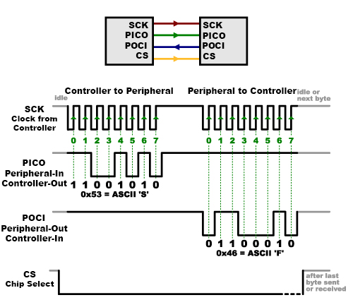
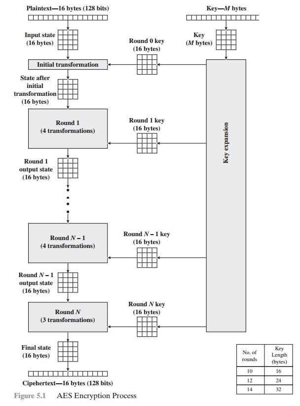
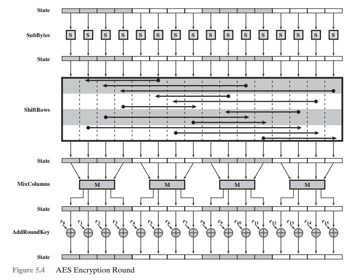
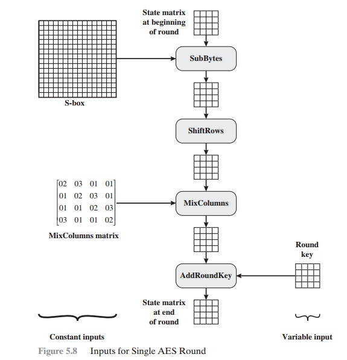

# Projeto Hands-on — RTL Design Track

## Relatório da Semana 1: Kick-off, Estudo Teórico (SPI e AES) e Ambiente

**Autor:** Anderson Pereira
**Documentos de Apoio:** [Planejamento-Projeto-Hands-on.pdf](../references/Planejamento-Projeto-Hands-on.pdf) | [nist.fips.197.pdf](../references/nist.fips.197.pdf) | [BACKLOG.md](BACKLOG.md)

---

## 1. Escopo e Organização Inicial

A primeira semana do projeto Hands-on (RTL Design Track) foi dedicada ao alinhamento do escopo de hardware, à preparação e validação do ambiente de desenvolvimento automatizado e ao aprofundamento teórico dos dois pilares funcionais do acelerador criptográfico:
1. **Interface Serial SPI (*Serial Peripheral Interface*)**: responsável pelo controle externo, parametrização e carga/leitura de registradores de controle e status (*CSR*);
2. **Núcleo Acelerador AES (*Advanced Encryption Standard*)**: motor criptográfico simétrico para processamento de blocos de 128 bits com chave configurável.

O sistema global concebido para este projeto é o **`AES Top-Level System`**, cujas partições contemplam blocos de Reset, PLL (*mockado* na fase inicial), banco de registradores (CSR), ponte de sincronização entre domínios assíncronos (*Clock Domain Crossing* - CDC entre o domínio serial e o domínio de sistema), o núcleo AES com datapath iterativo e a interface de acesso à memória de dados.

O gerenciamento de todas as entregas do projeto está consolidado no [Backlog do Projeto (BACKLOG.md)](BACKLOG.md), estruturado em 7 *User Stories* ao longo de 15 semanas.

---

## 2. Estudo do Protocolo SPI (Serial Peripheral Interface)

Inicia-se a documentação pelo protocolo SPI por se tratar de uma interface síncrona amplamente padronizada na indústria, de conceituação direta e fundamental para o desacoplamento entre o mundo externo e os registradores internos do IP.

### 2.1. Topologia de Sinais e Sinalização Temporal

O barramento SPI é uma interface síncrona, mestre-escravo (*Controller/Peripheral*), *full-duplex* de 4 vias de sinal. Em projetos modernos e especificações recentes (como as recomendações da OSHWA e fabricantes como SparkFun, Adafruit e NXP), adotam-se termos descritivos e inclusivos que substituem o jargão legado:

| Sinal Atual (Recomendado) | Sinal Legado | Direção | Função |
| :--- | :--- | :--- | :--- |
| **SCK** (*Serial Clock*) | SCK / SCLK | Controller $\to$ Peripheral | Sinal de clock gerado exclusivamente pelo mestre para ditar o ritmo de transmissão. |
| **CS** (*Chip Select*) / **CS_N** | SS / SS_N (*Slave Select*) | Controller $\to$ Peripheral | Habilitação do periférico (ativo em nível baixo, *active-low*). Delimita o quadro da transação. |
| **PICO** (*Peripheral In, Controller Out*) | MOSI (*Master Out, Slave In*) | Controller $\to$ Peripheral | Linha de transmissão de dados enviados pelo controlador para o periférico. |
| **POCI** (*Peripheral Out, Controller In*) | MISO (*Master In, Slave Out*) | Peripheral $\to$ Controller | Linha de recepção de dados transmitidos pelo periférico para o controlador. |

A dinâmica temporal dos sinais e a mecânica elementar de uma transação de dois bytes podem ser visualizadas na figura abaixo:

<p align="center">
  <br>
  <em>Figura 1 — Estrutura e Sinalização Temporal do Barramento SPI.</em>
</p>

#### Análise da Transação Ilustrada:
1. **Ativação da Transação**: O sinal **CS** transiciona de nível lógico alto (`1`) para nível lógico baixo (`0`), acordando o periférico, liberando a lógica interna de desvio serial (*Shift Register*) e zerando os contadores de amostragem de bits.
2. **Byte 1 — Escrita (*Controller to Peripheral*)**:
   - O controlador envia sequencialmente 8 bits pela linha **PICO**, sincronizados pelo sinal **SCK**.
   - No exemplo ilustrado, o valor transmitido é `0x53` (equivalente ao caractere ASCII `'S'`, representação binária `01010011` transmitido com bit mais significativo MSB primeiro).
   - Enquanto o primeiro byte é enviado, a linha **POCI** permanece em estado de repouso ou alta impedância, pois o periférico ainda está decodificando o comando de entrada.
3. **Byte 2 — Leitura (*Peripheral to Controller*)**:
   - O controlador continua gerando ciclos de clock na linha **SCK**.
   - O periférico coloca em **POCI** os dados solicitados, transmitindo o valor `0x46` (ASCII `'F'`, binário `01000110`).
   - Simultaneamente, a linha **PICO** pode transmitir dados nulos (*dummy bytes*, ex.: `0x00` ou `0xFF`) apenas para fornecer os pulsos de clock necessários à circulação do registrador de deslocamento.
4. **Encerramento da Transação**: Após o último bit amostrado, a linha **CS** retorna ao nível alto (`1`), encerrando a transação e sinalizando à FSM interna do periférico a prontidão dos dados.

### 2.2. Protocolo de Acesso a Registradores e Parametrização

Na grande maioria dos circuitos integrados e periféricos comerciais (sensores, memórias e aceleradores de hardware), o barramento SPI não transmite dados soltos de forma aleatória; adota-se um padrão estruturado baseado em **Quadros de Comando/Endereço seguidos de Dados**:

| Segmento do Quadro | Posição dos Bits | Campo | Descrição Funcional |
| :--- | :---: | :---: | :--- |
| **Byte 0: Comando & Endereço** | Bit `[7]` | `R/W` | Sentido da operação (`0` = Escrita / Write, `1` = Leitura / Read). |
| | Bit `[6]` | `Burst` / `Auto-inc` | Habilita auto-incremento de endereço para acesso a múltiplos bytes consecutivos. |
| | Bits `[5:0]` | `ADDR[5:0]` | Endereço do registrador interno a ser acessado no banco CSR. |
| **Bytes 1..N: Carga de Dados** | Bits `[7:0]` | `DATA_IN` / `DATA_OUT` | Payload de dados gravado via PICO (escrita) ou retornado via POCI (leitura). |


1. **Byte de Comando (Primeiro Byte)**:
   - **Bit de Direção (`R/W`)**: Comumente o MSB (bit 7) define se a operação é de Escrita (`0` = Write) ou Leitura (`1` = Read), ou vice-versa, dependendo do fabricante.
   - **Bit de Modo / Auto-incremento**: Permite que múltiplos bytes consecutivos sejam escritos ou lidos sequencialmente sem necessitar reinserir novos endereços a cada byte (*burst mode*).
   - **Campo de Endereço (`ADDR`)**: Define qual registrador interno do banco CSR (*Control and Status Register*) será lido ou alterado (ex.: registrador de controle do AES, ponteiro de bloco de chave, registrador de configuração do PLL).
2. **Bytes de Dados (Bytes Subsequentes)**:
   - **Operação de Escrita (Write)**: Nos bytes seguintes, o controlador envia a carga útil pela linha PICO. A cada 8 ciclos de SCK completados, o periférico captura o byte e o escreve no registrador apontado.
   - **Operação de Leitura (Read)**: O controlador fornece pulsos de clock mantendo PICO em repouso (*dummy data*), e o periférico desloca o conteúdo do registrador selecionado para a linha POCI.

> [!NOTE]
> Este padrão de acesso a registradores via byte de endereço/comando é documentado como prática padrão pela indústria em especificações como o *Motorola SPI Block Guide V04.01*, manuais da NXP, Texas Instruments e na nota de aplicação *Analog Devices AN-1248*.

### 2.3. Modos de Operação (CPOL e CPHA) e Padrões Industriais

Por se tratar de um padrão *de facto* criado pela Motorola (sem um comitê formal IEEE correspondente), a flexibilidade temporal é suportada por meio de dois parâmetros de configuração fundamentais:
- **CPOL (*Clock Polarity*)**: Define o estado de repouso (*idle*) do sinal de clock **SCK**.
  - `CPOL = 0`: O sinal SCK permanece em nível baixo (`0`) durante o repouso.
  - `CPOL = 1`: O sinal SCK permanece em nível alto (`1`) durante o repouso.
- **CPHA (*Clock Phase*)**: Define a relação de fase entre o clock e os dados, determinando a borda de amostragem (*sampling/latch*) e a borda de deslocamento (*shift/toggle*).
  - `CPHA = 0`: O primeiro bit é válido imediatamente quando **CS** vai a nível baixo; os dados são amostrados na primeira borda do clock e sofrem toggle na segunda borda.
  - `CPHA = 1`: Os dados sofrem toggle na primeira borda de clock e são amostrados na segunda borda.

A combinação desses dois parâmetros define os **4 Modos de Operação SPI**:

| Modo SPI | CPOL | CPHA | Estado de Repouso (SCK) | Borda de Amostragem (Latch) | Borda de Deslocamento (Shift) | Observações |
| :---: | :---: | :---: | :---: | :---: | :---: | :--- |
| **Modo 0** | `0` | `0` | Baixo (`0`) | Borda de Subida (*Rising*) | Borda de Descida (*Falling*) | **Modo mais comum** na indústria (utilizado na Figura 1). |
| **Modo 1** | `0` | `1` | Baixo (`0`) | Borda de Descida (*Falling*) | Borda de Subida (*Rising*) | Utilizado em sensores e conversores ADC/DAC específicos. |
| **Modo 2** | `1` | `0` | Alto (`1`) | Borda de Descida (*Falling*) | Borda de Subida (*Rising*) | Espelhado do Modo 0 com polaridade invertida. |
| **Modo 3** | `1` | `1` | Alto (`1`) | Borda de Subida (*Rising*) | Borda de Descida (*Falling*) | Segundo modo mais comum (suportado por memórias Flash SPI). |

### 2.4. Velocidades Comerciais e Implicações para o Projeto de Hardware

Em hardware comercial, as taxas de clock do SPI variam significativamente de acordo com a aplicação:
- **Sensores e periféricos simples (I/O expansores, displays modestos)**: Operam normalmente entre **100 kHz e 10 MHz**.
- **Microcontroladores padrão (STM32, ESP32, PIC, ARM Cortex-M)**: Portas SPI integradas alcançam tipicamente de **20 MHz a 50 MHz**.
- **Memórias Flash NOR SPI e interfaces Quad/Octal SPI (QSPI/OSPI)**: Dispositivos de alta densidade (Winbond, Macronix, Micron) alcançam de **80 MHz a 133 MHz** em Single Data Rate (SDR), ultrapassando **200 MHz** em interfaces DDR/Octal.

#### Desafio no Projeto (Clock Domain Crossing - CDC):
No presente projeto de acelerador criptográfico, o barramento SPI é acionado por um gerador de clock externo assíncrono (`SCLK`), enquanto o núcleo AES e o banco de registradores internos operam no clock do sistema (`clk_sys`) sintetizado pelo PLL. Essa convivência exige uma separação rigorosa de domínios:
- O estágio de deslocamento de bits e captura de pacotes roda no domínio do `SCLK`;
- Os sinais cruzam para o domínio de `clk_sys` através de sincronizadores de 2 flip-flops (para sinais de pulso/flag de pacote pronto) e registradores com barreira de handshake, eliminando riscos de metastabilidade.

---

## 3. Estudo do Algoritmo Criptográfico AES (Advanced Encryption Standard)

### 3.1. Visão Geral e Padronização (NIST FIPS-197)

O **AES (Advanced Encryption Standard)** é uma cifra de bloco simétrica padronizada pelo *National Institute of Standards and Technology* (NIST) em novembro de 2001, publicada formalmente como [NIST FIPS PUB 197](../references/nist.fips.197.pdf). Desenvolvida originalmente pelos criptógrafos belgas Joan Daemen e Vincent Rijmen sob o nome **Rijndael**, a cifra substituiu o antigo padrão DES (*Data Encryption Standard*), superando vulnerabilidades como tamanho de chave insuficiente (56 bits do DES) e baixa eficiência em implementações de software e hardware.

O AES opera exclusivamente sobre blocos de dados de tamanho fixo de **128 bits** (16 bytes), processando um bloco de texto plano (*Plaintext*) para gerar um bloco cifrado (*Ciphertext*).

### 3.2. Configurações de Chaves, Matriz de Estado (*State*) e Rodadas (*Rounds*)

O padrão FIPS-197 especifica três tamanhos possíveis para a chave de cifra (*Cipher Key*), os quais determinam diretamente o número de iterações ou rodadas (*Rounds*) necessárias para garantir imunidade contra criptoanálise linear e diferencial:

| Padrão | Tamanho da Chave ($K$) | Tamanho em Palavras ($N_k$) | Tamanho do Bloco ($N_b$) | Número de Rodadas ($N_r$) |
| :--- | :---: | :---: | :---: | :---: |
| **AES-128** | 128 bits (16 bytes) | 4 palavras (32 bits cada) | 4 palavras (128 bits) | **10 rodadas** |
| **AES-192** | 192 bits (24 bytes) | 6 palavras (32 bits cada) | 4 palavras (128 bits) | **12 rodadas** |
| **AES-256** | 256 bits (32 bytes) | 8 palavras (32 bits cada) | 4 palavras (128 bits) | **14 rodadas** |

> [!NOTE]
> *Nomenclatura do FIPS-197:* $N_b = 4$ representa o número de colunas (palavras de 32 bits) da matriz de estado (sempre fixo em 4 para 128 bits de bloco). $N_k$ denota a quantidade de palavras de 32 bits que compõem a chave fornecida. $N_r$ é o número de rodadas completas de cifragem.

O bloco de 128 bits é representado internamente como uma matriz bidimensional de bytes de dimensão $4 \times 4$, denominada **Matriz de Estado (*State Matrix*)**:

$$\text{State} = \begin{bmatrix} s_{0,0} & s_{0,1} & s_{0,2} & s_{0,3} \\ s_{1,0} & s_{1,1} & s_{1,2} & s_{1,3} \\ s_{2,0} & s_{2,1} & s_{2,2} & s_{2,3} \\ s_{3,0} & s_{3,1} & s_{3,2} & s_{3,3} \end{bmatrix}$$

Os bytes de entrada $in_0, in_1, \dots, in_{15}$ são mapeados sequencialmente coluna por coluna: $s_{r,c} = in_{r + 4c}$.

### 3.3. Fluxograma do Processo Geral de Cifragem

O fluxograma geral do processo de criptografia do AES é apresentado na figura a seguir, baseada na estrutura formal descrita no padrão e detalhada em [BrainKart - AES Structure](https://www.brainkart.com/article/AES%28Advanced-Encryption-Standard%29-Structure_8408/):

<p align="center">
  <br>
  <em>Figura 2 — Fluxograma Geral do Processo de Cifragem do AES.</em>
</p>

#### Etapas do Processo:
1. **Entrada de Texto Plano e Chave**: O bloco *Plaintext* de 16 bytes inicializa a matriz *Input State*. Simultaneamente, a chave de $M$ bytes (16, 24 ou 32 bytes) é alimentada no bloco de **Expansão de Chave (*Key Expansion*)**.
2. **Transformação Inicial (*Round 0*)**: Realiza-se uma operação inicial não-iterativa de `AddRoundKey` combinando o *State* com os primeiros 128 bits da chave original (*Round 0 Key*).
3. **Rodadas Intermediárias (*Rounds 1 a $N_r - 1$*)**: Cada rodada executa rigorosamente quatro transformações sequenciais:
   - `SubBytes`
   - `ShiftRows`
   - `MixColumns`
   - `AddRoundKey`
4. **Rodada Final (*Round $N_r$*)**: Executa apenas três transformações:
   - `SubBytes`
   - `ShiftRows`
   - `AddRoundKey`
   *(A etapa `MixColumns` é deliberadamente omitida na última rodada para manter a simetria entre o processo de cifragem e o de decifragem).*
5. **Saída Cifrada**: O estado resultante da rodada $N_r$ torna-se o *Ciphertext* final de 16 bytes (128 bits).

### 3.4. Anatomia dos Rounds e Transformações de Estado

Para compreender o fluxo de dados em hardware, o comportamento interno de cada round pode ser examinado sob duas perspectivas complementares:

#### Visão de Transformações do Round:
A figura abaixo ilustra a transição do vetor de estado ao atravessar as quatro etapas que compõem uma rodada padrão:

<p align="center">
  <br>
  <em>Figura 3 — Transformações e Evolução do Vetor de Estado em um Round AES.</em>
</p>

#### Visão de Entradas Fixas vs. Entradas Variáveis:
A figura a seguir detalha a categorização entre os operandos constantes da especificação matemática e os operandos que variam a cada ciclo de execução:

<p align="center">
  <br>
  <em>Figura 4 — Entradas Constantes (S-Box e MixColumns) e Variáveis (Round Key) de uma Rodada.</em>
</p>

- **Entradas Constantes (*Constant Inputs*)**:
  - **S-Box (16x16 bytes)**: Tabela de substituição não-linear fixa baseada na álgebra sobre o corpo de Galois $\text{GF}(2^8)$;
  - **Matriz de Multiplicação de MixColumns**: Matriz circular constante de coeficientes hexadecimais em $\text{GF}(2^8)$ aplicada a cada coluna.
- **Entradas Variáveis (*Variable Inputs*)**:
  - **Matriz de Estado (*State Matrix*)**: O bloco de dados sob processamento contínuo;
  - **Chave de Rodada (*Round Key*)**: Subchave de 128 bits calculada para cada round específico pelo algoritmo de *Key Expansion*.

### 3.5. Descrição Detalhada das Funções de Transformação

Conforme documentado em [BrainKart - AES Transformation Functions](https://www.brainkart.com/article/Advanced-Encryption-Standard(AES)-Transformation-Functions_8409/) e no NIST FIPS-197:

#### 1. SubBytes (Substituição Não-Linear de Bytes)
- Cada byte da matriz *State* é substituído individualmente por outro byte através de uma S-Box de 256 entradas.
- Matematicamente, a S-Box é obtida calculando o inverso multiplicativo do byte no corpo finito $\text{GF}(2^8)$ módulo o polinômio irredutível $m(x) = x^8 + x^4 + x^3 + x + 1$ (com `0x00` mapeado para ele mesmo), seguido por uma transformação afim invertível sobre $\text{GF}(2)$.
- **Propósito Criptográfico**: Prover **confusão**, quebrando qualquer relação linear simples entre a chave e o texto cifrado. Em RTL, pode ser sintetizada como uma tabela ROM/LUT de 256 bytes por instância ou via lógica combinacional composta em $\text{GF}(((2^2)^2)^2)$ para redução de área.

#### 2. ShiftRows (Permutação Cíclica de Linhas)
- Os bytes de cada linha da matriz *State* sofrem rotação circular para a esquerda de acordo com o índice da linha:
  - **Linha 0**: Nenhum deslocamento (permanece intacta);
  - **Linha 1**: Deslocamento circular de 1 byte para a esquerda;
  - **Linha 2**: Deslocamento circular de 2 bytes para a esquerda;
  - **Linha 3**: Deslocamento circular de 3 bytes para a esquerda.
- **Propósito Criptográfico**: Difusão entre as colunas. Em hardware, esta transformação tem **custo zero de área e latência nula**, pois corresponde a mero roteamento de fiação (*rewiring* de barramentos).

#### 3. MixColumns (Mistura Linear de Colunas)
- Cada coluna de 4 bytes da matriz *State* é multiplicada por uma matriz fixa de polinômios em $\text{GF}(2^8)$:
  $$\begin{bmatrix} s'_{0,c} \\ s'_{1,c} \\ s'_{2,c} \\ s'_{3,c} \end{bmatrix} = \begin{bmatrix} 02 & 03 & 01 & 01 \\ 01 & 02 & 03 & 01 \\ 01 & 01 & 02 & 03 \\ 03 & 01 & 01 & 02 \end{bmatrix} \begin{bmatrix} s_{0,c} \\ s_{1,c} \\ s_{2,c} \\ s_{3,c} \end{bmatrix}$$
- A multiplicação por $\{02\}$ (conhecida como operação `xtime`) corresponde a um shift para a esquerda de 1 bit seguido de um XOR condicional com `0x1B` se o bit 7 for 1. A multiplicação por $\{03\}$ é obtida por $\{02\} \cdot x \oplus x$.
- **Propósito Criptográfico**: Prover alta **difusão** espacial, garantindo que a alteração de um único bit no estado inicial altere todas as colunas nas rodadas seguintes (*efeito avalanche*).

#### 4. AddRoundKey (Adição da Chave de Rodada)
- Os 128 bits da matriz *State* passam por uma operação lógica XOR ($\oplus$) bit a bit com os 128 bits da *Round Key* correspondente:
  $$s'_{r,c} = s_{r,c} \oplus k_{r,c}$$
- **Propósito Criptográfico**: É a transformação responsável por introduzir a dependência do segredo da chave nos dados. Em RTL, consiste em um arranjo simples de 128 portas XOR de 2 entradas.

#### 5. Key Expansion (Expansão de Chave)
- A chave de entrada gera uma sequência de palavras de 32 bits $w[0], w[1], \dots, w[4N_r + 3]$.
- Para o AES-128 ($N_k=4$), as primeiras 4 palavras ($w[0..3]$) correspondem à própria chave.
- As palavras seguintes são geradas recursivamente:
  - Se $i$ for múltiplo de 4: $w[i] = w[i-4] \oplus \text{SubWord}(\text{RotWord}(w[i-1])) \oplus \text{Rcon}[i/4]$;
  - Caso contrário: $w[i] = w[i-4] \oplus w[i-1]$.
- Onde `RotWord` realiza um shift cíclico de 1 byte, `SubWord` aplica a S-Box aos 4 bytes, e `Rcon` é a constante de rodada em $\text{GF}(2^8)$.

---

## 4. Ambiente de Desenvolvimento e Automação de Build

Em consonância com as exigências da Semana 1 descritas no [Planejamento-Projeto-Hands-on.pdf](../references/Planejamento-Projeto-Hands-on.pdf), o repositório foi totalmente estruturado e verificado.

### 4.1. Estrutura de Diretórios do Repositório

```bash
CIExpert/secondRound/
├── docs/                # Documentação técnica centralizada
│   ├── references/      # Normas técnicas e planejamento (FIPS-197, Planejamento)
│   ├── architecture/    # Diagramas e documento de arquitetura
│   ├── spec/            # Especificações de blocos e registradores
│   └── reports/         # Relatórios semanais e imagens de suporte
│       ├── images/semana_01/
│       ├── BACKLOG.md   # Backlog geral estruturado em User Stories
│       └── semana_01.md # Este documento de entrega da Semana 1
├── rtl/                 # Fontes sintetizáveis em SystemVerilog
├── tb/                  # Testbenches dirigidos e de integração
├── models/              # Modelos comportamentais de simulação (PLL e Memória)
├── syn/                 # Scripts TCL e constraints SDC de síntese lógica
├── formal/              # Scripts e configurações para o Synopsys Formality
├── upf/                 # Arquivos de intenção de potência (IEEE 1801 UPF)
├── scripts/             # Scripts utilitários de build e automação
├── libs/                # Bibliotecas de células padrão e ponteiros PDK
├── build/               # Artefatos intermediários gerados pelas ferramentas
└── Makefile             # Automação single-command do fluxo completo
```

### 4.2. Fluxo Automatizado via Makefile

O repositório disponibiliza um [Makefile](../../Makefile) centralizado e autodocumentado, que atende rigorosamente ao critério de aceite da semana 1 (*"o fluxo mínimo pode ser executado com um único comando"*):

- `make help`: Exibe o catálogo interativo de alvos disponíveis;
- `make lint`: Executa a checagem estática de sintaxe e regras de estilo (*Design Compiler / SpyGlass*);
- `make sim`: Compila e executa o ambiente de simulação básico com *Synopsys VCS*;
- `make syn`: Executa a síntese lógica com mapeamento para o PDK Synopsys SAED 32nm;
- `make formal`: Executa a verificação formal de equivalência lógica via *Synopsys Formality*;
- `make clean`: Limpa o diretório de build e artefatos temporários.

---

## 5. Próximos Passos (Semana 2 — Arquitetura e Microarquitetura)

Com base no cronograma e critérios de aceite estabelecidos no [Planejamento-Projeto-Hands-on.pdf](../references/Planejamento-Projeto-Hands-on.pdf) e na **User Story 1** do [Backlog do Projeto](BACKLOG.md), as atividades da Semana 2 consistirão em:

1. **Elaboração do Diagrama de Blocos de Alto Nível**: Mapear detalhadamente as partições do `AES Top-Level System`: bloco de RESET, PLL mockado, controlador SPI Slave, banco de registradores (CSR), memória mockada e núcleo AES.
2. **Especificação das Interfaces de Topo e Contratos**: Detalhar portas, larguras de barramento e protocolos de handshake para:
   - `GLOBAL RESET` (assíncrono, ativo baixo);
   - `clk from OSC` (clock de entrada do oscilador);
   - `SPI IF` (`CS_N`, `SCK`, `PICO/MOSI`, `POCI/MISO`);
   - `MEMORY DATA IF` (interface de leitura/escrita de blocos de payload criptográfico).
3. **Mapeamento do Banco de Registradores (CSR)**: Especificar tabela de registradores acessíveis via SPI, contendo endereços, campos de bit, permissões de leitura/escrita (`RW` / `RO`) e bits de status/controle (início de cifragem, chave carregada, interrupções, configuração do PLL).
4. **Estratégia de Clock, Reset e Sincronização (CDC)**:
   - Definir a distribuição e polaridade das árvores de reset;
   - Tratar a travessia assíncrona entre o domínio `SCLK` (SPI) e `clk_sys` (saída do PLL), especificando sincronizadores 2-FF e esquemas de passagem estável de dados;
   - Definir o comportamento do PLL mockado (sinal `locked` e bloqueio de reprogramação prévia).
5. **Definição da Microarquitetura do AES**:
   - Justificar a escolha da arquitetura (arquitetura iterativa com 1 round por ciclo de clock vs. desenrolada);
   - Definir a interface interna do núcleo AES para comunicação com CSR e memória de dados.
6. **Consolidação do Documento de Arquitetura v1.0**: Preparação do relatório técnico e apresentação dos diagramas para revisão e alinhamento com o parceiro da trilha de *Design Verification (DV)*.

---

## 6. Referências Bibliográficas

1. **National Institute of Standards and Technology (NIST)**. *Specification for the ADVANCED ENCRYPTION STANDARD (AES)*. Federal Information Processing Standards Publication (FIPS PUB) 197, novembro de 2001. [Disponível em docs/references/nist.fips.197.pdf](../references/nist.fips.197.pdf).
2. **BrainKart**. *AES (Advanced Encryption Standard) Structure*. BrainKart Engineering Articles. [Link Web](https://www.brainkart.com/article/AES%28Advanced-Encryption-Standard%29-Structure_8408/).
3. **BrainKart**. *Advanced Encryption Standard (AES) Transformation Functions*. BrainKart Engineering Articles. [Link Web](https://www.brainkart.com/article/Advanced-Encryption-Standard%28AES%29-Transformation-Functions_8409/).
4. **CUNHA, Henrique**. *Planejamento — Projeto Hands-on: RTL Design Track (Acelerador AES com interface SPI e baixo consumo)*. CI Brasil / Softex, 2026. [Disponível em docs/references/Planejamento-Projeto-Hands-on.pdf](../references/Planejamento-Projeto-Hands-on.pdf).
5. **Motorola / Freescale / NXP Semiconductors**. *SPI Block Guide V04.01*. Motorola Inc., 2004.
6. **Open Source Hardware Association (OSHWA) / SparkFun Electronics**. *A Resolution to Redefine SPI Signal Names (PICO/POCI Terminology)*, 2020.
7. **Analog Devices**. *Serial Peripheral Interface (SPI) - Application Note AN-1248*. Analog Devices Inc., 2013.
8. **Texas Instruments**. *Key Considerations for Serial Peripheral Interface (SPI) Hardware Design*. Application Report SLAA408A, Texas Instruments Inc.